<p align="center">
  <picture>
  <source media="(max-width: 600px) and (prefers-color-scheme: dark)" srcset="docs/brand/readme-banner-dark-mobile.svg">
  <source media="(max-width: 600px)" srcset="docs/brand/readme-banner-light-mobile.svg">
  <source media="(prefers-color-scheme: dark)" srcset="docs/brand/readme-banner-dark.svg">
  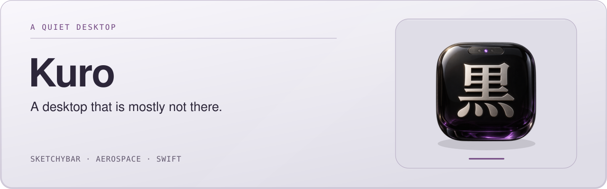
</picture>

<picture>
  <source media="(max-width: 600px) and (prefers-color-scheme: dark)" srcset="docs/brand/readme-showcase-dark-mobile.svg">
  <source media="(max-width: 600px)" srcset="docs/brand/readme-showcase-light-mobile.svg">
  <source media="(prefers-color-scheme: dark)" srcset="docs/brand/readme-showcase-dark.svg">
  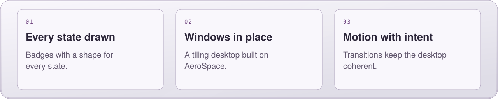
</picture>
</p>

<p align="center">
  
  
  
  
  
  <a href="LICENSE"></a>
</p>

<p align="center">
  <a href="#the-bar">The bar</a> ·
  <a href="#every-state-drawn">Every state</a> ·
  <a href="#now-playing">Now Playing</a> ·
  <a href="#workspaces">Workspaces</a> ·
  <a href="#motion">Motion</a> ·
  <a href="#engineering">Engineering</a> ·
  <a href="#architecture">Architecture</a> ·
  <a href="#the-kuro-app">The app</a> ·
  <a href="#install">Install</a> ·
  <a href="#on-omarchy">Omarchy</a> ·
  <a href="#keys">Keys</a>
</p>

<br>

<p align="center">
  <b>黒, kuro: black.</b><br>
  A desktop that is mostly not there.
</p>

Windows tile themselves. The menu bar becomes a few dark pills floating over
your wallpaper. Every badge on it disappears the moment it has nothing to tell
you, every state it can be in has a shape of its own, and everything that
changes, moves: nothing on this desktop ever snaps.

Kuro is a complete macOS environment built on
[AeroSpace](https://github.com/nikitabobko/AeroSpace),
[SketchyBar](https://github.com/FelixKratz/SketchyBar) and
[JankyBorders](https://github.com/FelixKratz/JankyBorders). Where those stop, it
carries on with its own Swift: four background watchers, seven renderers that
draw every badge pixel by pixel, a 60 fps transition and tween engine, a Core
Audio tap for a live waveform, and a Location-authorised probe for the one
piece of Wi-Fi that macOS now treats as location data.

<br>

<p align="center">
  <a href="#every-state-drawn">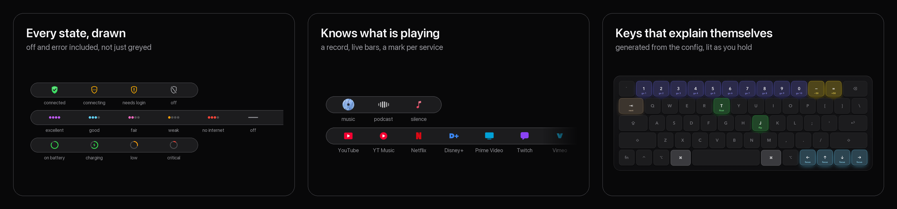</a>
</p>

<br>

<p align="center">
  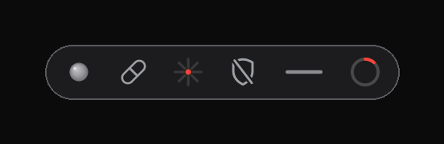
</p>

<p align="center">
  
</p>

<br>

<table align="center">
  <tr>
    <td align="center" width="16%"><h2>12,000</h2>lines of Swift</td>
    <td align="center" width="16%"><h2>19</h2>native programs</td>
    <td align="center" width="16%"><h2>24</h2>plugins</td>
    <td align="center" width="16%"><h2>60 fps</h2>every animation</td>
    <td align="center" width="16%"><h2>11</h2>services recognised</td>
    <td align="center" width="16%"><h2>28</h2>golden images</td>
  </tr>
</table>

<br>

## The bar

It lives in the strip where the macOS menu bar would be, and steps aside when
you reveal the real one. **Click shows, right-click flips**: a click opens a
badge's card, a right-click flips what the badge is about. The clock is the one
the other way round: a click is Notification Center, as on any Mac, and a
right-click opens its card.

| Part | What it shows |
|---|---|
| **Workspaces** | The workspaces on each screen, darker when empty, and the app in focus there with its own icon. An empty screen shows the void, a small black hole. [More below](#workspaces). |
| **Now Playing** | Title, artist and a mark for what is playing: a spinning cover for music, live bars for a podcast, the service's own mark for a browser tab, and a music note when nothing is. Titles are measured to fit before they are shown. [More below](#now-playing). |
| **Badges** | One pill, left to right: OrbStack, keep-awake, vitals, Claude usage, Tailscale, Wi-Fi and the battery. Each hides itself when it does not apply. |
| **Clock** | The time, and nothing else. Click for Notification Center, as on the real clock; right-click for the date card. |

| Badge | Click | Right-click |
|---|---|---|
| **Keep awake** | how long the Mac has been kept awake, since when, the screen saver; off, the last session | keep awake / let it sleep |
| **Claude usage** | the five-hour session, which the burst is drawn from, and the week | opens the card |
| **Tailscale** | on or off since when, tailnet, address, and the exit node with a row that turns it on or off | connect / disconnect |
| **Wi-Fi** | network and how long you have been on it, an internet check, signal and noise, band, channel, rate, security, address, router | Wi-Fi on / off |
| **Vitals** | how busy the processor is, memory used and its pressure, the busiest app, and a row into the Vitals app for temperatures, GPU and disks | opens Vitals |
| **Battery** | charge, on battery or on power since when, draw in watts, time left, health | opens the card |
| **OrbStack** | only what is running, each VM and Compose project (the name opens its site, the state stops it), and Quit all | opens the card |
| **Now Playing** | previous, play/pause, next, shuffle and repeat | play / pause, from silence too |
| **Clock** | Notification Center | the date card: the day, the ISO week, the day of the year, the month drawn with its week numbers, and your calendar |

<table>
  <tr>
    <td width="25%" valign="top" align="center">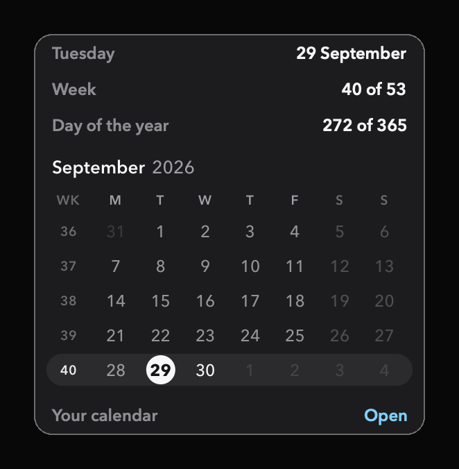<br><sub>Clock: the day, the week, the month</sub></td>
    <td width="25%" valign="top" align="center">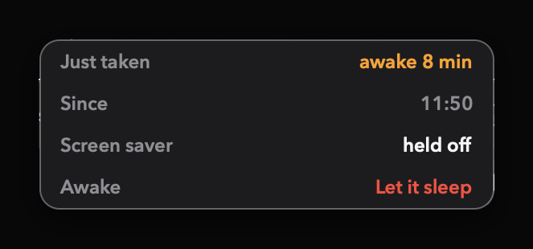<br><sub>Keep awake: the session, since when, the screen saver</sub></td>
    <td width="25%" valign="top" align="center">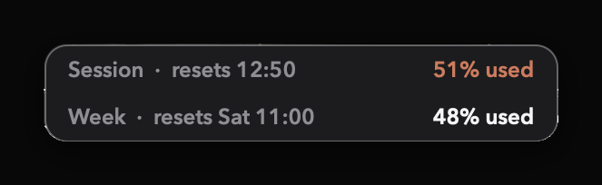<br><sub>Claude: the session and the week</sub></td>
    <td width="25%" valign="top" align="center">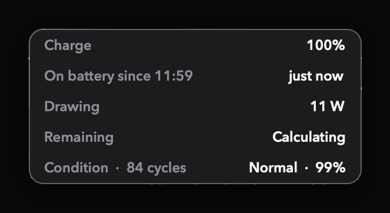<br><sub>Battery: charge, source, draw, time left, health</sub></td>
  </tr>
</table>

## Every state, drawn

A badge answers one question in a colour and a shape, and a badge that is off
or cannot reach its source says so in a shape of its own rather than in a
colour you have to remember. Every cell below is the renderer's own still, the
PNG the bar shows; `docs/make_states.py` rebuilds the sheet from them.

<p align="center">
  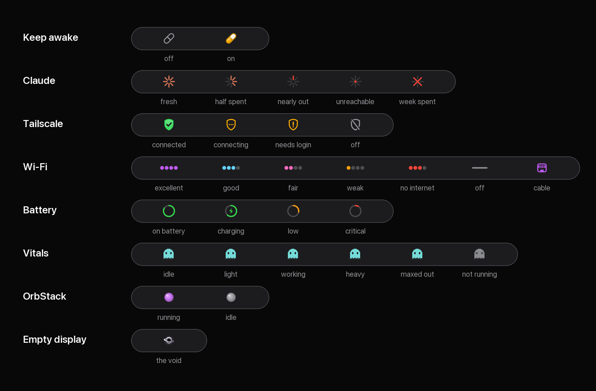
</p>

- **Keep awake** is a capsule, after the pill Amphetamine made the keep-awake
  icon. Switched on, its halves part a fraction and snap together on a spring,
  the colour fills from the seam and a glint runs once along it; switched off,
  the colour drains as the halves open and close again, empty. It holds
  `caffeinate` and the screen saver both, and puts the screen saver back as it
  was.
- **Claude** is a burst whose eight rays go out as the five-hour session is
  spent. With no reading for twenty minutes it does not guess: the rays go out
  clockwise and a red dot pops into the hub. When the weekly limit is spent
  its own lines become a red cross, drawn stroke by stroke, until the week
  resets.
- **Tailscale** is a drawn shield. Connecting, it fills green with a pop and
  the check draws itself in, stroke by stroke; disconnecting, the check is
  taken back and a slash is struck through the outline. Three amber dots rise
  while it connects; an amber exclamation mark drops in when the tailnet wants
  a login.
- **Wi-Fi** is four dots lit by the signal (-55, -65, -75 and -85 dBm), all one
  colour, and the colour is the count: orange, pink, cyan, purple. Red means the
  signal is fine and the internet is not, told apart from a sign-in page by the
  same captive-portal check macOS uses. Off, the dots glide together into one
  grey flatline.
  On a cable the dots slide across into the four pins of a network port and
  its socket springs in around them; the card turns to the cable, with the
  adapter, link speed, address and router, and keeps the Wi-Fi switch.
- **Battery** is a ring, no percentage, green, amber under 35% and red under
  12%. Plugging in springs a bolt into the middle and sends a comet once round
  the ring.
- **Vitals** is a pixel ghost after NeoHtop's, pin-sharp at one design pixel
  a point, its colour a heat scale of how hard the Mac is working: teal idle,
  green, yellow, orange, red maxed out, and red whatever the processor when
  memory pressure is critical. It stays still; when the load changes it hops,
  a small rise and a springy landing, as its colour eases round the colour
  wheel. While the Vitals app is not running it dies: it shivers, drains to
  grey and gets crosses for eyes, and hops back to life when Vitals starts.
  The numbers are read directly; right-click opens Vitals itself.
- **OrbStack** is an orb that lights up purple with a ripple when anything
  starts.
- **The void** is what an empty screen shows: a black hole, its accretion ring
  lensed up over the top of the horizon, that opens as the screen empties.

## Now Playing

The pill knows what is playing, not only that something is.

<p align="center">
  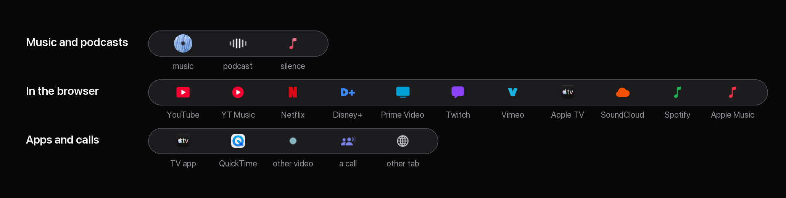
</p>

- **Music** gets its cover as a record, drawn at 2x so it is sharp on Retina,
  spinning at 60 fps under a fixed glint of light the way a real record turns
  under a lamp. Play and pause wind it up and down like a platter; paused, the
  colour drains out of it to grey.
- **Podcasts** get six bars that move to the voice itself, from a Core Audio
  tap on the playing app, in Spotify and Apple Podcasts alike.
- **Browser tabs** are recognised by asking the browser which tab is playing:
  eleven services wear their own mark, from YouTube and Netflix to SoundCloud
  and Apple Music on the web. Dia, Arc, Safari and the Chrome family can be
  asked; Firefox cannot, and keeps a good guess.
- **Video apps** show their own app icon, and calls in Teams, Zoom and
  FaceTime a call icon
  beside a meeting clock, `12:04 ~ Teams`, counting from when the call began.
  A meeting never reaches Now Playing, so it is found by who has the
  microphone: Core Audio names the process capturing input, and a call app
  doing so is a call. Whatever was playing comes back when it ends.
- **Titles always fit.** Title and artist are measured in the bar's own font
  against the real room, from the end of the workspace pill to the notch, and
  re-fitted whenever the workspace pill changes width. The artist goes first,
  then the title is shortened on a word.
- **Silence is shown, not hidden.** With nothing playing, or a pause longer
  than 30 seconds, the pill closes down to a music note in a capsule of its
  own: the system's `music.note` glyph, filled with the pink-to-red of Apple
  Music. It does not move; it only glows a little, once every eight seconds.
  A right-click plays again.

A new track lifts the old title away and brings the next one up under a cover
that springs into place. Music stopping is one continuous movement: the words
lift away, the capsule glides shut around the slot, and a third of the way in
the cover has shrunk away and the note springs up in its place. Music
starting runs it backwards, the capsule opening to exactly the width the new
title will take before the title rises into it, so nothing jumps when it lands. `mediawatch --demo` plays both without any audio.

## Workspaces

Workspace numbers belong to screens, so a number always takes you to the same
place.

| Screens | Main | Second | Third | Fourth |
|---|---|---|---|---|
| 1 | 1 to 10 | | | |
| 2 | 1 to 5 | 6 to 10 | | |
| 3 | 1 to 4 | 5 to 7 | 8 to 10 | |
| 4 | 1 to 3 | 4 to 6 | 7 to 8 | 9 to 10 |

The main screen comes first and the rest follow left to right. Plug a screen in
or out and every workspace moves to where it now belongs; open a new one and it
appears on its own screen; move one by hand with
<kbd>⌥</kbd>&nbsp;<kbd>⇧</kbd>&nbsp;<kbd>⌘</kbd> and an arrow and it stays put
until the screens change again.

On the bar, each screen shows its own workspaces. Switching, the chip shrinks
away on one digit and springs up on the next, before the bar has asked
AeroSpace anything, because the new workspace rides along with the event. The
focused app's icon pops in as its name crossfades and rises. When the focused
workspace is the last one on its screen, the app steps 6pt further away on the
chip's own spring: a white circle needs less air than a digit to look as far
off, and without it the app read as one more workspace.

What agents open stays out of the way. A browser an agent drives (Playwright's
Chromium, WebKit and Firefox, the iOS Simulator, a bare Electron app) goes
straight to an agent space, a hidden workspace F1 to F12, before it can land
where you work, and each browser process gets one of its own, so two agents
testing at once never share a screen. Apps an agent starts with `open`, from
Zeron or Claude Code, go the same way (`install.sh --agent-open`): `~/.local/bin/open` is the system's open
for you, and for an agent it opens in the background and claims the app, so the
window it brings up is sent to an agent space and not dropped on your work.
On the bar they are one chip in
TestFlight's colours: solid blue with a white propeller and the space's name
on a screen showing one, beside the number it came from, which stays drawn so
one click takes you home; a quiet blue propeller and a count while agents have
windows out of sight. ⌃⌘1 to 0, − and = look in on F1 to F12, the layer just
above the workspaces' own ⌘1 to 0, and ⌃⌘⇥ comes back; ⌃⌥⌘ with the same keys
sends a window there. The chip goes to the next one with windows.

## Motion

Everything moves at 60 frames a second, the display's own rate: the badges'
drawn transitions, the property tweens, the record and the podcast bars. Every
state has its own way in and out, off and error included, and between changes
nothing moves at all and nothing is redrawn.

The GIF at the top is not a screen recording: `docs/make_motion.py` composes it
from the renderers' own transition frames, so it is exactly as sharp as the bar.

## Engineering

The interesting part of Kuro is what had to be built because the obvious way
did not work. Every one of these was measured before it was fixed.

| The problem | What was built | Result |
|---|---|---|
| SketchyBar's hover events are unusable here: with the pointer parked on a probe item, **13 `mouse.exited` in 3 s and not one `mouse.entered`** | `hoverwatch`, which reads the pointer directly. Cards opened after a short dwell until hovering near the top also dragged the real menu bar down over the bar; now a click opens a card and leaving it closes it | Cards that open when you mean it and never flicker |
| SketchyBar's `--animate` does nothing on this machine | `motionwatch`: a frame player for drawn transitions plus a 60 fps property tween engine with a client that any shell plugin can call | **36 frames in 0.6 s at 60 fps**, the animator idle at rest, timers suspended between changes |
| A drawn animation queued in the tween engine outlived what replaced it: switch back from an empty screen quickly and the void's remaining frames landed over the app's icon | Anything that writes an animated property goes through the engine too, where a new request for a property cancels what is still queued for it | The latest intent always wins |
| 60 fps is not free: every frame swap redraws the whole bar | Measured it, SketchyBar at **7% CPU at 24 fps and 17.5% at 60** while something plays, and spent it only where the eye is: the record and the podcast bars run at 60, the slow breathing marks stay at 24 | Smooth where it shows, cheap where it does not |
| macOS 26 locks down Now Playing and never sends `media_change` | `mediawatch` on `media-control`'s stream, with a Core Audio process tap for a real waveform, shipped as a signed app bundle so the audio permission survives rebuilds | A player pill that knows music, podcasts, video and calls apart |
| A browser's media session never says which site is playing, so Netflix, Twitch and Disney+ all wore the YouTube mark | `mediaservice.swift` asks the browser over AppleScript for its tabs, finds the playing one by title (or the one streaming tab, since Netflix keeps its tab title to itself) and reads the service off the host, once per track, in the background | Eleven services with their own mark, and video apps with their own icon |
| Long song titles ran into the MacBook notch: the title was fitted by a character count, and a count cannot promise a width (a W is three times an i) | `mediafit.swift` measures title and artist in the bar's own font and fits them to the real room, re-fitting whenever the workspace pill changes width | Titles always fit |
| The cover was drawn at 1x from when both screens were 1x, the one soft thing on a Retina bar, and 150 frames of it at 60 fps took 287 ms on the queue that runs the track-change animation | Drawn at 2x and rendered in parallel, every frame on its own core | **21 ms** for a real cover, sharp on every screen |
| AeroSpace crashed on monitor changes with three screens (upstream issue #506: `Monitor.activeWorkspace` recursing until the stack ran out), and fourteen bar scripts were each asking it questions right in the middle of the reconfiguration | One sync script that waits for the displays to settle and asks one question at a time, plus a launchd agent that restarts AeroSpace after a crash but not after a quit | From about twenty concurrent calls per monitor change to a handful in sequence; a crash is back in **1 s** |
| Workspace numbers should belong to screens, and AeroSpace's force-assignment cannot express a split that depends on how many screens there are | The same sync script shares 1 to 10 out across the screens after they settle, and places new workspaces as they appear | One screen 1 to 10, two 1 to 5 and 6 to 10, and so on, tested against a stand-in AeroSpace for one to four screens |
| Since macOS 14 the Wi-Fi network's name is location data: CoreWLAN answers nil, and `ipconfig`, `scutil` and `system_profiler` all print `<redacted>` | `wifiinfo`, a CoreWLAN probe shipped as a signed app bundle with a Location usage description and the location entitlement Hardened Runtime demands, launched through LaunchServices so macOS checks the permission against the bundle rather than against SketchyBar | Signal, noise, rate, channel, security and the network's name in **0.1 s**, where `system_profiler` took 5.8 s and still redacted the name |
| The Claude badge went red after eight idle hours: the sign-in token had expired, and `claude auth status`, the obvious way to make Claude Code renew it, never does | On an expired token the badge asks Claude Code for one word from Haiku in safe mode, so Claude Code renews its own credential; nothing here ever writes to the keychain | Renewed in about **3 s** with the smallest request there is, at most every 10 minutes |
| The usage endpoint rate-limits hard (HTTP 429) and one bad poll blanked the badge | Keep the last reading, restore it from disk after a reload, show the error mark only when it is genuinely stale | A badge that is never missing and never lies |
| The pill had to glide between a title and the silence's music note, 332pt down to 44, and SketchyBar cannot animate an item's width; worse, `width=dynamic` lands a frame after the rest of a change, and that frame measured **437pt** for a pill settling at 332 | Walk an explicit width at 60 fps with the title emptied (a set title holds its rect even at zero alpha), aimed at a width model fitted to the bar: glyph-path bounds rounded up, plus constants measured on seven real layouts. The title keeps an explicit width from then on, so there is no late frame to show | Stop and start in one glide, the capsule never jumping, sampled frame by frame |
| Marks rendered at 1x smeared on a Retina panel | Every renderer draws at two pixels per displayed point; stills are **SHA-256 golden images**, checked in under a second | 28 states that cannot silently change |
| Fixed-width items do not reserve their padding, so spacing drifted | Measured SketchyBar's real geometry and derived every padding from a single `ITEM_GAP`, re-measured on the bar whenever a mark changes shape | One 16 pt gap everywhere, from one number |
| The real macOS menu bar slid down over the bar on every brush of the top edge, greying the bar out under it and shutting any open card, and no setting keeps it hidden: "automatically hide" only hides it until the pointer touches the top | Measured the reveal: a strip about **6pt** deep, and the pointer in it for **60 to 120ms**. Pushing the pointer back out lost to a hand still pushing up, so `topguard` taps mouse events where they enter the system and never lets one land in that strip; a screen with another above it keeps its edge open | The menu bar never comes down; the pointer stops at the top like at a side |
| Closing Notification Center from the clock flashed it shut and open again, because the click that closes it also ran the shortcut that opens it | `ncstate` reads the window list and the click only presses the shortcut when the panel is not on screen | One click opens, one click closes |
| Quitting OrbStack relaunched it, twice over | Found both paths: an AppleScript `tell` that starts what it tells, and a CLI status call mid-shutdown | Quit stays quit |

<details>
<summary><b>Design principles</b></summary>

<br>

- **Glance first.** A badge answers one question in a colour and a shape. The
  numbers live one click away.
- **Every state has a shape.** Off, pending and error are drawn, not merely
  greyed: a flatline, a struck shield, a red dot in the hub.
- **Absent beats idle.** Anything that does not apply hides: no VPN, no
  shield; no OrbStack, no orb; a desktop, no battery.
- **Click shows, right-click flips.** A click opens the card; a right-click
  flips what the badge is about. Apps and pages are one click further, in the
  card.
- **Nothing snaps, nothing idles.** Every change animates; between changes
  nothing is drawn.
- **Measured, not guessed.** Every gap, rate and threshold came from a
  measurement, and the reasoning sits in a comment beside the number.
- **Never lie.** A failed reading is shown as failed, a stale one as stale, a
  toggle that cannot read back its state claims nothing.

</details>

## Architecture

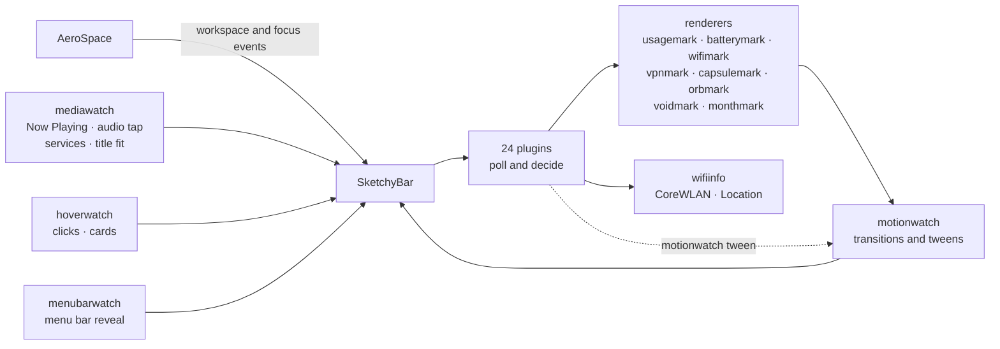

| Program | Lines | Does |
|---|---:|---|
| `mediawatch` | 5,700 | Now Playing: metadata, cover art, the spin, the live waveform, service recognition, title fitting, track and playback transitions |
| `motionwatch` | 419 | Plays drawn transitions and runs property tweens for everything else |
| `hoverwatch` | 420 | Opens cards on click, animates their arrival, closes them on a second click or 5 s after the pointer leaves |
| `menubarwatch` | 249 | Notices the macOS menu bar being revealed and clears the way, tracking the displays live |
| `usagemark` | 401 | Draws the Claude burst, its transitions, its error mark and the weekly-limit cross |
| `vpnmark` | 282 | Draws the Tailscale shield in four states, the check drawing itself in |
| `capsulemark` | 249 | Draws the keep-awake capsule, snapping shut and filling |
| `wifimark` | 249 | Draws the Wi-Fi dots, their transitions and the flatline |
| `orbmark` | 213 | Draws the OrbStack orb and its ripple |
| `voidmark` | 209 | Draws the void, a black hole for an empty screen, and its horizon opening |
| `vitalsmark` | 238 | Draws the vitals ghost after NeoHtop's in a heat-scale colour, and its hop on a change |
| `batterymark` | 206 | Draws the battery ring, its bolt and the plug-in comet |
| `monthmark` | 186 | Draws the clock card's month: ISO week numbers, today on a disc, this week on a band |
| `wifiinfo` | 125 | Reads the Wi-Fi link through CoreWLAN, from a Location-authorised bundle |
| `topguard` | 116 | Keeps the macOS menu bar from coming down: an event tap holds the pointer below each screen's top strip, with an optional opening at the top centre (`MENUBAR_REVEAL_WIDTH`) |
| `Kuro.app` | 2038 | The setup and manager app (`app/`, SwiftUI): onboarding, badges with live previews, your keys, health, updates |
| `zorder` | 63 | Checks no pill's window is stacked over its badges, for the bar's self-heal |
| `vitalsinfo` | 41 | Reads CPU ticks and memory the way Activity Monitor counts them |
| `ncstate` | 17 | Says whether Notification Center is on screen |

Every program is compiled from source by the plugin that needs it the first
time it runs, rebuilt when its source changes, and restarted on every reload.
[`sketchybar/README.md`](sketchybar/README.md) goes through the whole system:
the layout rules, the cards, the watchers, the drawn marks, and the traps found
on the way.

## The Kuro app

<p align="center">
  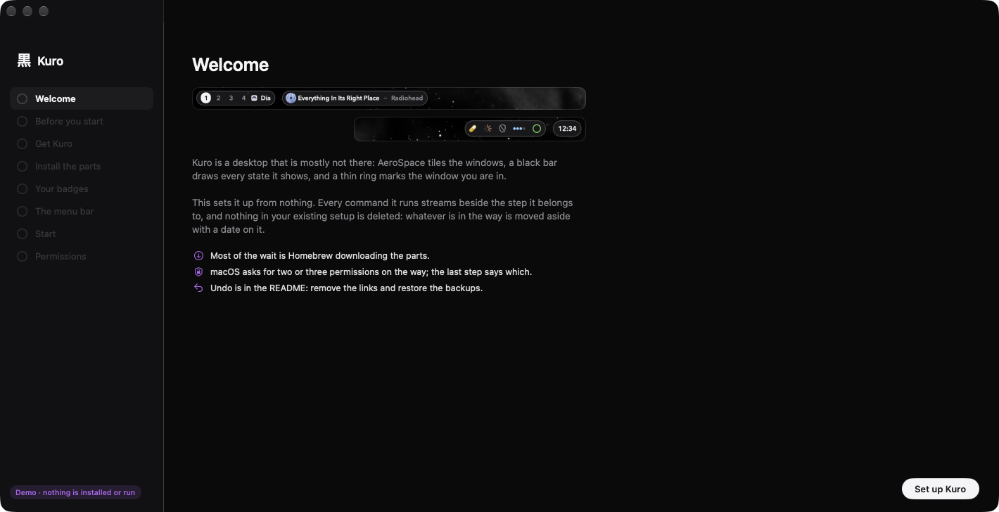
</p>

A native SwiftUI app sets Kuro up and keeps it that way. Setup goes from nothing
installed to a running bar in eight steps, and every command it runs streams in a
console beside the step it belongs to, so nothing happens out of sight. Each
step's ring closes as its command lands. The badge previews are drawn by the
bar's own renderers, not pictures of them.

<table>
  <tr>
    <td width="50%" valign="top">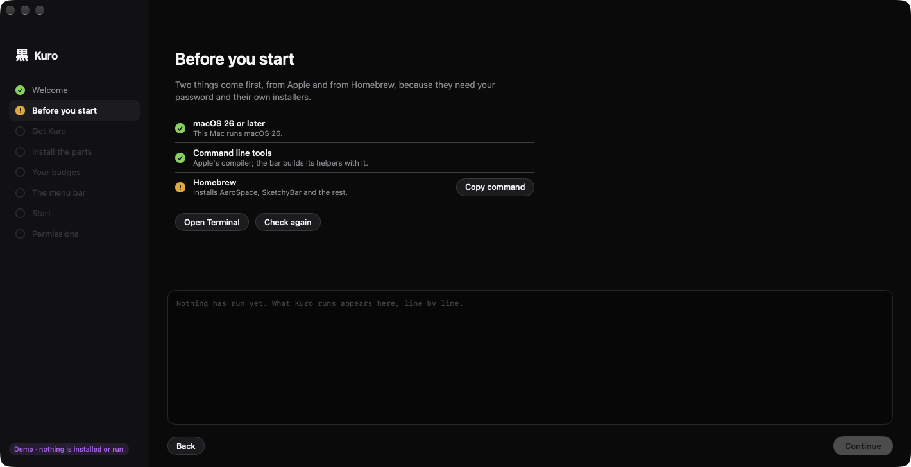<br><sub><b>Before you start.</b> What Apple and Homebrew must install themselves, checked, with the way to do it.</sub></td>
    <td width="50%" valign="top">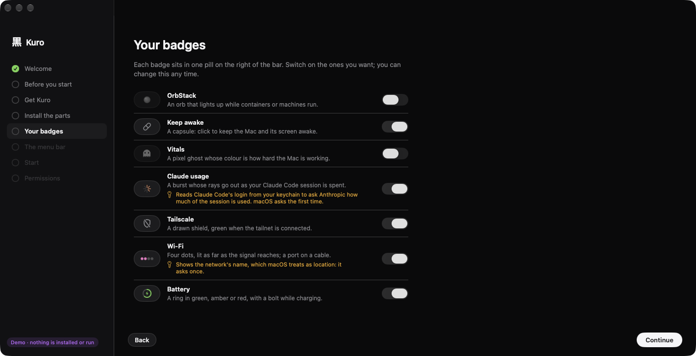<br><sub><b>Your badges.</b> Live previews; a badge that reads something of yours says so before it is on.</sub></td>
  </tr>
  <tr>
    <td width="50%" valign="top">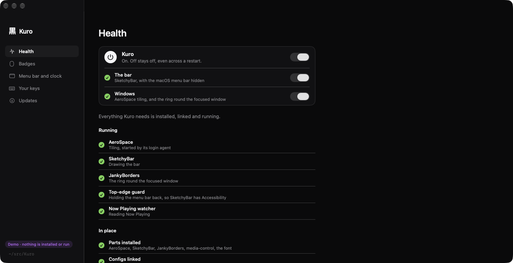<br><sub><b>Health.</b> What is running and in place, read from the Mac, with reload, restart, repair and the checks.</sub></td>
    <td width="50%" valign="top">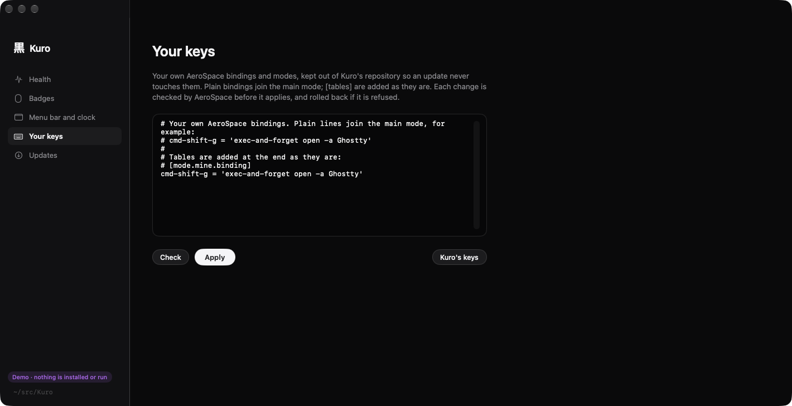<br><sub><b>Your keys.</b> Your own bindings, outside the repository, checked by AeroSpace's dry run and rolled back if refused.</sub></td>
  </tr>
</table>

Afterwards the same window is the manager. Its first switch turns Kuro off and
on, all of it or the bar and the window manager apart: off, the macOS menu bar
comes back and windows stay where they are; on, each window returns to the
workspace it had. Off stays off across a restart. `scripts/kuro.sh on|off
[bar|windows]` is the same switch from a terminal. The rest: badges, the menu bar opening, the
clock's calendar, agent spaces, your keys, and updates, which pull from GitHub,
rebuild what changed and list it first. Permissions are inferred from what is
running and said so where they cannot be known; macOS does not let one app read
another's. The screenshots are `--demo` mode, a made-up Mac
(`docs/make_app_shots.sh`).

## Install

You need macOS 26 on Apple silicon. The easy way is the app: download
`Kuro.zip` from [Releases](https://github.com/mostlygino/Kuro/releases), open
`Kuro.app` (it is unsigned, so the first time: right-click, Open) and follow
it. It checks for the Xcode command line tools and [Homebrew](https://brew.sh),
fetches Kuro into a folder you choose, and runs the installer below for you.

From a terminal it is the same installer, and it builds the app into
`~/Applications` as well:

```sh
git clone https://github.com/mostlygino/Kuro.git ~/src/Kuro
cd ~/src/Kuro
./install.sh --deps --hide-menubar
```

| Flag | Does |
|---|---|
| `--deps` | installs SketchyBar, JankyBorders, AeroSpace, `media-control` and Hack Nerd Font |
| `--hide-menubar` | sets the macOS menu bar to hide itself, which the bar needs: they share the strip |
| `--no-start` | links everything but starts nothing |
| `--no-app` | skips building the Kuro app |
| `--agent-open` | adds the `open` for coding agents (see [Workspaces](#workspaces)) |

The installer symlinks the configs into place, so `git pull` updates the running
desktop. Anything already there is moved to `<path>.backup-<time>` first, and it
is safe to run again. AeroSpace is started by a launchd agent
(`launchd/sh.kuro.aerospace.plist`) rather than its own login item, so it comes
back by itself if it ever crashes. The first start takes about 20 seconds while
the bar compiles its helpers, and macOS asks for a few permissions along the way:
Location for the Wi-Fi name, audio recording for the podcast bars, and control of
your browser for recognising what a tab is playing.

The badges light up for what you have. Keep-awake, Wi-Fi, the battery and
[Tailscale](https://tailscale.com) are there from the start (each hides itself
when it does not apply); [OrbStack](https://orbstack.dev) and
Vitals when those apps are installed. The
[Claude Code](https://claude.com/claude-code) usage badge reads Claude Code's
login from your keychain, so it is off until you switch it on. A badge that is
off is never built at all: no item, no script, nothing polled.

## On Omarchy

<p align="center">
  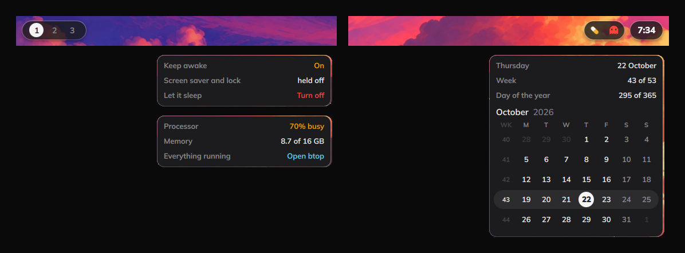
</p>

Kuro also runs on [Omarchy](https://omarchy.org) 4.5, as an Omarchy shell bar plugin: the same pills,
chips, Now Playing, drawn badges and cards, redrawn in QML, and Kuro's gaps and focus ring in Hyprland. One
script switches it on and off; see [`linux/omarchy`](linux/omarchy/README.md).

```sh
~/src/Kuro/linux/omarchy/install.sh          # --off for Omarchy's own bar
```

## Keys

The bindings are Omarchy's, ported from Hyprland to AeroSpace with
<kbd>⌘</kbd> standing in for the Super key. Windows keep 40 pt from every edge
and the focused one wears a thin white border.

<p align="center">
  <a href="docs/KEYS.md"></a>
</p>

| Keys | Does |
|---|---|
| <kbd>⌘</kbd>&nbsp;<kbd>←</kbd>&nbsp;<kbd>↑</kbd>&nbsp;<kbd>↓</kbd>&nbsp;<kbd>→</kbd> | Focus the window in that direction |
| <kbd>⌘</kbd>&nbsp;<kbd>1</kbd>&nbsp;…&nbsp;<kbd>0</kbd> | Go to a workspace, on the screen it belongs to |
| <kbd>⇧</kbd>&nbsp;<kbd>⌘</kbd>&nbsp;<kbd>1</kbd>&nbsp;…&nbsp;<kbd>0</kbd> | Take the window there and follow it |
| <kbd>⌘</kbd>&nbsp;<kbd>⇥</kbd> &nbsp;·&nbsp; <kbd>⌥</kbd>&nbsp;<kbd>⇥</kbd> | Next workspace · next window |
| <kbd>⌃</kbd>&nbsp;<kbd>⌘</kbd>&nbsp;<kbd>1</kbd>&nbsp;…&nbsp;<kbd>0</kbd> &nbsp;·&nbsp; <kbd>⌃</kbd>&nbsp;<kbd>⌘</kbd>&nbsp;<kbd>⇥</kbd> | Look in on an agent space · back to where you were |
| <kbd>⌘</kbd>&nbsp;<kbd>T</kbd> &nbsp;·&nbsp; <kbd>⌘</kbd>&nbsp;<kbd>J</kbd> &nbsp;·&nbsp; <kbd>⌥</kbd>&nbsp;<kbd>⌘</kbd>&nbsp;<kbd>F</kbd> | Float or tile · flip the split · fullscreen |
| <kbd>⇧</kbd>&nbsp;<kbd>⌘</kbd>&nbsp;<kbd>/</kbd> | The interactive reference |

All 89 bindings are in [`docs/KEYS.md`](docs/KEYS.md): keycaps, the layers at a
glance, four sections. The interactive version, [`docs/keys.html`](docs/keys.html),
is a keyboard that lights up under the modifiers you hold, with search; GitHub
shows it as source, so open it locally or press <kbd>⇧</kbd>&nbsp;<kbd>⌘</kbd>&nbsp;<kbd>/</kbd>.
Both are generated from `aerospace.toml` by `docs/make_keys.py`, so they are
always what the Mac does.

<details>
<summary><b>Make it yours</b></summary>

<br>

| File | For |
|---|---|
| `~/.config/kuro/settings` | Which badges, what the clock opens, the menu bar opening. `key=value` lines, read (never run) by `colors.sh`, so only known keys of the right shape count. |
| `~/.config/kuro/aerospace.local.toml` | Your own AeroSpace bindings and modes. `scripts/kuro-apply.sh` (and <kbd>⌥</kbd>&nbsp;<kbd>⌘</kbd>&nbsp;<kbd>C</kbd>) merges them into `~/.aerospace.toml`, checks the result with AeroSpace and rolls back if it is rejected. Plain bindings go into the main mode, tables at the end. |
| `sketchybar/local.sh` | The rest, as shell, never committed; it wins over the settings file. Created from `local.sh.example`: a signing identity so macOS remembers the watchers' permissions, what clicking the app name does, an SSH tunnel row for the Tailscale card. |
| `sketchybar/colors.sh` | Palette, fonts, pill sizes, the one gap used everywhere, card widths. |
| `aerospace.toml` | Kuro's keybindings and gaps. Edit your own file above rather than this one, and `git pull` never fights you. |

```sh
brew services restart sketchybar     # restart the bar
sketchybar --reload                  # reload its config
sketchybar/plugins/motion_demo.sh    # play one transition on every badge
sketchybar/assets/render_test.sh     # check the drawn badges still render
python3 docs/make_motion.py          # rebuild the GIF
python3 docs/make_states.py          # rebuild the states and marks sheets
python3 docs/make_anatomy.py         # rebuild the labelled bar
python3 docs/make_keys.py            # rebuild the keybinding reference
python3 docs/make_highlights.py      # rebuild the tiles at the top
```

</details>

<details>
<summary><b>Uninstall</b></summary>

<br>

```sh
brew services stop sketchybar
defaults write NSGlobalDomain _HIHideMenuBar -bool false && killall SystemUIServer
rm ~/.config/sketchybar ~/.aerospace.toml ~/.config/borders/bordersrc
```

Then restore any `*.backup-*` the installer made, and quit AeroSpace.

</details>

## Credits

Built by [mostlygino](https://github.com/mostlygino), pair-programmed with
[Claude Code](https://claude.com/claude-code). Standing on SketchyBar and
JankyBorders by Felix Kratz, AeroSpace by Nikita Bobko, and
[media-control](https://github.com/ungive/media-control), which is what still
reads Now Playing on current macOS.

## Contributing

Issues and pull requests are welcome; [CONTRIBUTING.md](CONTRIBUTING.md) has how to run the checks, and
[SECURITY.md](SECURITY.md) how to report a vulnerability privately.

## Licence

Code: AGPL-3.0-or-later ([LICENSE](LICENSE)). Name, icon and artwork: all rights reserved, see [BRAND.md](BRAND.md).

<br>

<a href="https://mostlygino.com">
  <picture>
    <source media="(max-width: 600px) and (prefers-color-scheme: dark)" srcset="https://raw.githubusercontent.com/mostlygino/mostlygino/main/assets/signoff/built-with-love-dark-mobile.svg">
    <source media="(max-width: 600px)" srcset="https://raw.githubusercontent.com/mostlygino/mostlygino/main/assets/signoff/built-with-love-light-mobile.svg">
    <source media="(prefers-color-scheme: dark)" srcset="https://raw.githubusercontent.com/mostlygino/mostlygino/main/assets/signoff/built-with-love-dark.svg">
    
  </picture>
</a>
