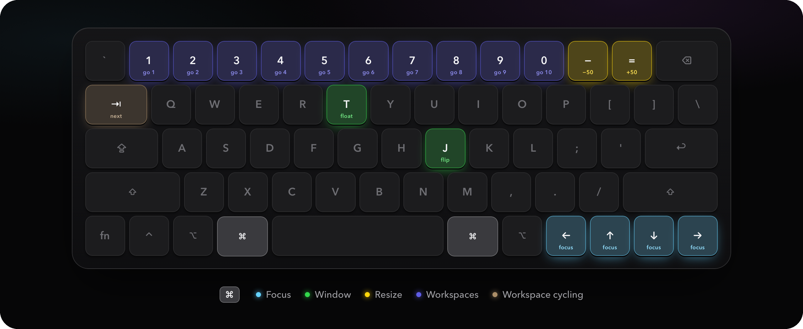

<h1 align="center">Keys</h1>

All 89 AeroSpace bindings in Kuro, read straight out of <a href="../aerospace.toml"><code>aerospace.toml</code></a>, so this page cannot drift from the config. The layout follows Omarchy, with <kbd>⌘</kbd> in the place of its Super key.

The <kbd>⌘</kbd> layer. Each key wears its group's colour and the word for what it does.

> [!TIP]
> <kbd>⇧</kbd>&nbsp;<kbd>⌘</kbd>&nbsp;<kbd>/</kbd> opens the interactive version: the same keyboard, lighting up under whatever modifiers you hold, with search. GitHub shows [`keys.html`](keys.html) as source, so open it locally with `open docs/keys.html`.

<kbd>⌘</kbd> Command &nbsp; <kbd>⌥</kbd> Option &nbsp; <kbd>⌃</kbd> Control &nbsp; <kbd>⇧</kbd> Shift &nbsp; <kbd>⇥</kbd> Tab &nbsp; <kbd>⌫</kbd> Delete

<a href="#windows">Windows</a> · <a href="#workspaces">Workspaces</a> · <a href="#screens">Screens</a> · <a href="#everything-else">Everything else</a>

## At a glance

The same keys work on every layer; the modifiers you hold decide what moves. <em>Take</em> moves the window and follows it, <em>send</em> moves it and stays.

| Hold | <kbd>←</kbd>&nbsp;<kbd>↑</kbd>&nbsp;<kbd>↓</kbd>&nbsp;<kbd>→</kbd> | <kbd>1</kbd>&nbsp;…&nbsp;<kbd>0</kbd> | <kbd>⇥</kbd> |
|---|:---:|:---:|:---:|
| <kbd>⌘</kbd> | Focus | Go | Next workspace |
| <kbd>⇧</kbd>&nbsp;<kbd>⌘</kbd> | Swap | Take | Previous workspace |
| <kbd>⌥</kbd>&nbsp;<kbd>⇧</kbd>&nbsp;<kbd>⌘</kbd> | To screen | Send |  |
| <kbd>⌥</kbd>&nbsp;<kbd>⌘</kbd> | Stack |  |  |
| <kbd>⌃</kbd>&nbsp;<kbd>⌘</kbd> |  | Agent | Back to the last workspace |
| <kbd>⌃</kbd>&nbsp;<kbd>⌥</kbd>&nbsp;<kbd>⌘</kbd> |  | To agent |  |
| <kbd>⌥</kbd> |  |  | Next window |
| <kbd>⌥</kbd>&nbsp;<kbd>⇧</kbd> |  |  | Previous window |
| <kbd>⌃</kbd>&nbsp;<kbd>⌥</kbd> |  |  | Next screen |
| <kbd>⌃</kbd>&nbsp;<kbd>⌥</kbd>&nbsp;<kbd>⇧</kbd> |  |  | Previous screen |

## Windows

Arrows move between windows; the modifiers decide what comes along.

| Keys | Does |
|---|---|
| <kbd>⌘</kbd>&nbsp;<kbd>←</kbd>&nbsp;<kbd>↑</kbd>&nbsp;<kbd>↓</kbd>&nbsp;<kbd>→</kbd> | Focus the window in that direction |
| <kbd>⇧</kbd>&nbsp;<kbd>⌘</kbd>&nbsp;<kbd>←</kbd>&nbsp;<kbd>↑</kbd>&nbsp;<kbd>↓</kbd>&nbsp;<kbd>→</kbd> | Swap with the window in that direction |
| <kbd>⌥</kbd>&nbsp;<kbd>⌘</kbd>&nbsp;<kbd>←</kbd>&nbsp;<kbd>↑</kbd>&nbsp;<kbd>↓</kbd>&nbsp;<kbd>→</kbd> | Stack with the window in that direction |
| <kbd>⌃</kbd>&nbsp;<kbd>⌥</kbd>&nbsp;<kbd>⌫</kbd> | Close every other window |
| <kbd>⌘</kbd>&nbsp;<kbd>T</kbd> | Float or tile the window |
| <kbd>⌥</kbd>&nbsp;<kbd>⌘</kbd>&nbsp;<kbd>F</kbd> | Fullscreen |
| <kbd>⌘</kbd>&nbsp;<kbd>J</kbd> | Flip the split |
| <kbd>⌥</kbd>&nbsp;<kbd>⇥</kbd> | Next window |
| <kbd>⌥</kbd>&nbsp;<kbd>⇧</kbd>&nbsp;<kbd>⇥</kbd> | Previous window |
| <kbd>⌘</kbd>&nbsp;<kbd>−</kbd> | Shrink by 50 pt |
| <kbd>⌘</kbd>&nbsp;<kbd>=</kbd> | Grow by 50 pt |
| <kbd>⇧</kbd>&nbsp;<kbd>⌘</kbd>&nbsp;<kbd>−</kbd> | Shrink by 200 pt |
| <kbd>⇧</kbd>&nbsp;<kbd>⌘</kbd>&nbsp;<kbd>=</kbd> | Grow by 200 pt |

## Workspaces

Workspace numbers belong to screens: one screen has 1 to 10, two share 1 to 5 (main) and 6 to 10, three 1 to 4, 5 to 7 and 8 to 10. The bar keeps them there whenever a screen comes or goes. The agent spaces F1 to F12 are hidden workspaces for what agents open, one layer up on the same number row.

| Keys | Does |
|---|---|
| <kbd>⌘</kbd>&nbsp;<kbd>1</kbd>&nbsp;…&nbsp;<kbd>0</kbd> | Go to workspace 1 to 10 |
| <kbd>⇧</kbd>&nbsp;<kbd>⌘</kbd>&nbsp;<kbd>1</kbd>&nbsp;…&nbsp;<kbd>0</kbd> | Move the window to workspace 1 to 10 and follow |
| <kbd>⌥</kbd>&nbsp;<kbd>⇧</kbd>&nbsp;<kbd>⌘</kbd>&nbsp;<kbd>1</kbd>&nbsp;…&nbsp;<kbd>0</kbd> | Move the window to workspace 1 to 10, stay here |
| <kbd>⌘</kbd>&nbsp;<kbd>⇥</kbd> | Next workspace |
| <kbd>⇧</kbd>&nbsp;<kbd>⌘</kbd>&nbsp;<kbd>⇥</kbd> | Previous workspace |
| <kbd>⌃</kbd>&nbsp;<kbd>⌘</kbd>&nbsp;<kbd>⇥</kbd> | Back to the last workspace |
| <kbd>⌃</kbd>&nbsp;<kbd>⌥</kbd>&nbsp;<kbd>S</kbd> | Go to the scratch workspace |
| <kbd>⌃</kbd>&nbsp;<kbd>⌥</kbd>&nbsp;<kbd>⇧</kbd>&nbsp;<kbd>S</kbd> | Send the window to the scratch workspace |
| <kbd>⌃</kbd>&nbsp;<kbd>⌘</kbd>&nbsp;<kbd>1</kbd>&nbsp;…&nbsp;<kbd>0</kbd> | Look at agent space F1 to F10 |
| <kbd>⌃</kbd>&nbsp;<kbd>⌘</kbd>&nbsp;<kbd>−</kbd> | Look at agent space F11 |
| <kbd>⌃</kbd>&nbsp;<kbd>⌘</kbd>&nbsp;<kbd>=</kbd> | Look at agent space F12 |
| <kbd>⌃</kbd>&nbsp;<kbd>⌥</kbd>&nbsp;<kbd>⌘</kbd>&nbsp;<kbd>1</kbd>&nbsp;…&nbsp;<kbd>0</kbd> | Send the window to agent space F1 to F10, stay here |
| <kbd>⌃</kbd>&nbsp;<kbd>⌥</kbd>&nbsp;<kbd>⌘</kbd>&nbsp;<kbd>−</kbd> | Send the window to agent space F11, stay here |
| <kbd>⌃</kbd>&nbsp;<kbd>⌥</kbd>&nbsp;<kbd>⌘</kbd>&nbsp;<kbd>=</kbd> | Send the window to agent space F12, stay here |

## Screens

| Keys | Does |
|---|---|
| <kbd>⌃</kbd>&nbsp;<kbd>⌥</kbd>&nbsp;<kbd>⇥</kbd> | Next screen |
| <kbd>⌃</kbd>&nbsp;<kbd>⌥</kbd>&nbsp;<kbd>⇧</kbd>&nbsp;<kbd>⇥</kbd> | Previous screen |
| <kbd>⌥</kbd>&nbsp;<kbd>⇧</kbd>&nbsp;<kbd>⌘</kbd>&nbsp;<kbd>←</kbd>&nbsp;<kbd>↑</kbd>&nbsp;<kbd>↓</kbd>&nbsp;<kbd>→</kbd> | Move the workspace to the screen in that direction |

## Everything else

| Keys | Does |
|---|---|
| <kbd>⌥</kbd>&nbsp;<kbd>⌘</kbd>&nbsp;<kbd>C</kbd> | Apply your own bindings and reload AeroSpace |
| <kbd>⇧</kbd>&nbsp;<kbd>⌘</kbd>&nbsp;<kbd>/</kbd> | Open this reference |

---

Generated by <code>python3 docs/make_keys.py</code>, which also writes <code>keys.html</code> and <code>keys.png</code>. Edit the config, not this file.
