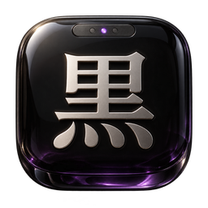

# Kuro icon

Quiet · obsidian and platinum. A tactile skeuomorphic identity, part of Gino's collection with Shīru as the material-quality reference.

- `master.png`: original generated RGBA artwork; preserve transparency.
- `icon.png`: 256 px README and UI asset.
- `favicon-32.png` and `favicon.ico`: small browser exports.
- No external requests or fonts are required by the icon.

Artwork generated with the built-in image generator on 2026-10-03. PNG/ICO exports are resized from the master.

## Generation prompt

Use case: stylized-concept. Create a single stunning premium skeuomorphic macOS app icon for Kuro, a minimal black macOS desktop with subtle purple lighting. One almost-square ink-black polished obsidian tile with deep continuous rounded corners; sculpted from solid black glass with a gentle convex face and fine smoky translucency at its lower edge. A large Japanese character 黒 in satin platinum is physically inlaid into the center, beautifully precise bevel edges and soft contact shadow. Near the top edge a single slim dark brushed-metal menu bar inset, containing three tiny understated indicator dots, one lit violet. A faint plum amethyst reflection glows through the lower edge of the obsidian, not a neon outline. Monochrome luxurious object, visually quiet, remarkable reflections and believable weight, readable dominant silver glyph. Straight-on orthographic, warm upper-left softbox lighting and restrained cool fill, tangible material realism like a crafted Japanese desk object. Square composition, tile occupies 82% width and height, 9% true transparent margin all around. No extra frame, no gradients pretending to be a flat icon, no illustration backdrop, no text other than 黒, no logos, no watermark, no mockup. 1024 square.

## README materials

`readme-theme.json` defines this app’s paper, cloth, enamel, glass or stone treatment. `python3 docs/brand/readme_art.py` regenerates both colour schemes of the banner and feature cards from the existing icon. Artwork is self-contained SVG; screenshots retain their original pixels.
