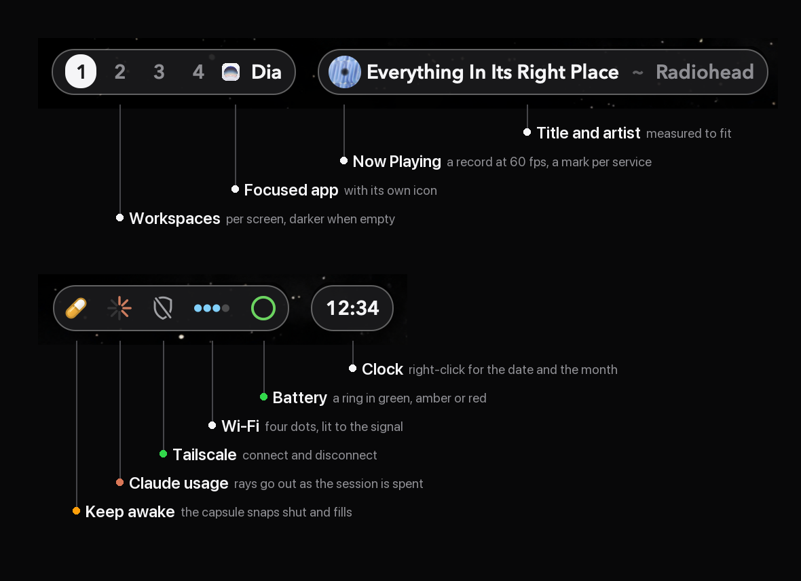

<p align="center">
  
</p>

# The bar, inside

How Kuro's SketchyBar works: the layout rules, the cards, the watchers, the
drawn marks, and the traps found on the way. For the tour, see the
[README](../README.md) at the top of the repository.

<p align="center">
  <a href="#layout">Layout</a> ·
  <a href="#click-shows-right-click-flips">Clicks and cards</a> ·
  <a href="#talking-to-aerospace">AeroSpace</a> ·
  <a href="#watchers">Watchers</a> ·
  <a href="#motion">Motion</a> ·
  <a href="#drawn-marks">Drawn marks</a> ·
  <a href="#commands">Commands</a> ·
  <a href="#files">Files</a>
</p>

## Layout

The bar itself draws nothing. It is a 66 pt transparent container that places
three floating pills and a run of badges; the fill, border and shadow live on
the brackets, so the middle of the screen stays bare desktop.

| Pill | Holds |
|---|---|
| **Workspaces** | The workspaces on that screen, empty ones in a darker digit, and the app in focus there with its own icon. The label is bright when the screen has focus and muted when it only reports what sits there, so two bars never claim the same window. A screen with nothing on it says "void" beside a small black hole (`assets/voidmark`) whose horizon opens as the screen empties. |
| **Now Playing** | `Title ~ Artist` beside a slot that says what is playing: the cover as a spinning record for music (2x, under a fixed glint, draining to grey when paused), six live bars for a podcast, the service's own mark for a browser tab (see `assets/mediaservice.swift`), an app's own icon for a video app, a call icon for Teams, Zoom or FaceTime with a meeting clock in place of the title (`12:04 ~ Teams`; any helper of a call app counts, a meeting's media comes from Teams' modulehost; a meeting is detected by a call app capturing the microphone, `assets/mediacall.swift`, since it never reaches Now Playing), and a globe for any other tab. With nothing playing, or after a 30 s pause (`MEDIA_PAUSE_HIDE_AFTER`), it closes down to a music note (`music.note`, in Apple Music's pink-to-red) in a 44pt capsule, glowing once every eight seconds, rather than going away. |
| **Badges** | Left to right: the OrbStack orb (only while a VM or container runs), the keep-awake capsule, the vitals ghost, the Claude usage burst, the Tailscale shield, the Wi-Fi dots and the battery ring. Each hides itself when it does not apply. |
| **Clock** | The time alone. A click opens Notification Center; a right-click opens the date card. |

The two left pills describe what you are doing; the right end holds what you
act on. The player and the badges appear on the main screen only; workspaces,
the app and the clock appear on every screen. Every gap is derived from one
number, `ITEM_GAP` (16 pt) in `colors.sh`, measured against SketchyBar's real
geometry.

## Click shows, right-click flips

A click opens a badge's card, through `plugins/card_click.sh`, which asks the
running `hoverwatch` to toggle it. A second click, or moving the pointer away,
closes it. A right-click (or alt-click) flips what the badge is about instead;
badges with nothing to flip open their card. The clock is the other way round,
because a click on a Mac's clock has always been Notification Center: there the
right-click opens the card.

| Badge | Shows | Card | Right-click |
|---|---|---|---|
| **Keep awake** | a capsule, filled while the Mac is kept awake | how long it has been on and since when, the screen saver; off, the last session | keep awake / let it sleep |
| **Claude** | rays left in the five-hour session; a red cross of its own rays while the weekly limit is spent | used and reset time for the session and the week | opens the card |
| **Tailscale** | a green shield with a check, a struck shield when off, amber dots while connecting | on or off since when, tailnet, address, and the exit node with a row that turns it on or off | connect / disconnect |
| **Wi-Fi** | four dots lit by the signal, all one colour by count (orange, pink, cyan, purple), red without internet, a grey flatline when off; a network port on a cable, purple online and red without internet | network and since when, internet check, signal and SNR, band and channel, rate, security, address, router latency | Wi-Fi on / off |
| **Vitals** | a pixel ghost after NeoHtop's in a heat scale of the load: teal idle, green, yellow, orange, red maxed out (CPU averaged; levels at 15, 40, 70 and 85% with a 5-point dead band); memory pressure warms it, critical is red; grey with crossed-out eyes while the Vitals app is not running | processor, memory used, memory pressure, the busiest app (named after its app, not its helper), and a row that opens Vitals, or starts it when it is down | opens Vitals |
| **Battery** | the charge as a ring in green, amber or red, a bolt on power | charge, on battery or on power since when, draw, time left, condition | opens the card |
| **OrbStack** | purple, and only there while a VM or container runs | only what is running: each VM and Compose project (the name opens its site, the state stops it), then Quit all | opens the card |
| **Now Playing** | what is playing | previous, play/pause, next, shuffle, repeat | play / pause |
| **Clock** | the time | the day, the ISO week and how many the year has, the day of the year, the month drawn by `assets/monthmark`, and a row that opens your calendar (`CLOCK_CLICK`) | opens the card; a click is Notification Center |

Cards opened on hover until 2026-09-29. Hovering near the top of the screen
also brought the real menu bar down over the bar, which greyed the badges out
and shut the card, so a click opens them now.

Closing still follows the pointer, read directly in `assets/hoverwatch.swift`
rather than from SketchyBar's own mouse events. Those are not usable here:
with a probe item and the pointer parked on it, **13 `mouse.exited` in three
seconds and not one `mouse.entered`**. Stop `mediawatch` and the noise stops
with it; the spinning record makes SketchyBar re-evaluate hover against a
pointer that has not moved.

Every card is filled from a detail file its plugin writes on each poll, never
at the moment it opens: a popup is laid out from its members, so filling it
late makes it resize on screen. `plugins/popup_rows.sh` applies one of those
files, and `plugins/since.py` works out the "since" rows. The two badges that poll slowly also
read afresh the moment their card opens (`plugins/on_open_claude.sh`, at most
every 30 s because the usage endpoint rate-limits, and
`plugins/on_open_battery.sh`), so a card is never minutes behind.

## Talking to AeroSpace

One script, `plugins/aerospace_sync.sh` on one hidden item, updates every
workspace chip and app label, and keeps each workspace on the screen it
belongs to.

| Screens | Main | Second | Third | Fourth |
|---|---|---|---|---|
| 1 | 1 to 10 | | | |
| 2 | 1 to 5 | 6 to 10 | | |
| 3 | 1 to 4 | 5 to 7 | 8 to 10 | |
| 4 | 1 to 3 | 4 to 6 | 7 to 8 | 9 to 10 |

When the screens change it shares all ten out again; otherwise it only places
new workspaces, so one moved by hand stays put. It never moves a workspace a screen is
showing: that is the move that crashes AeroSpace (upstream #506), and with
three screens it once did so thirteen times running, each restart undone by
the next pass. A screen showing someone else's workspace is switched to its own
first, and the one it was showing, hidden now, goes home; focus returns to
where it was, and this happens once per screen change, never in a loop. A workspace switch takes the
fast path: the new workspace rides along with AeroSpace's event
(`FOCUSED_WORKSPACE`), so the chip moves before the bar has asked anything.

The app label keeps an even distance from the chips. After a bare digit it has
13.5pt of air; after the focused chip's filled circle the same padding left
only 6, the gap between two chips, so the app looked like another workspace.
When a screen's last chip is its focused one, the label's `padding_left` goes
from `APP_GAP` (1) to `APP_GAP_AFTER_CHIP` (7), 11pt from the circle, which
reads as the same distance, and it glides there on the chip's spring, in the
fast path too. (Its `icon.padding_left` would not do: an icon with an explicit
width ignores its own left padding.)

It used to be fourteen items each asking AeroSpace for themselves, about
twenty calls at once on every monitor change, landing while macOS was still
rearranging the displays. That is the race behind AeroSpace's crash on monitor
changes (upstream issue #506), and with three screens it happened. Now the
sync waits 1.5 s after a display change, asks one thing at a time, and folds
overlapping triggers into one pass.

AeroSpace runs under launchd (`launchd/sh.kuro.aerospace.plist`, with
`start-at-login = false` in `aerospace.toml`), so a crash is restarted within a
second and a quit stays a quit.

## Watchers

Four background processes, each rebuilt from source when it changes and
restarted by its plugin on every `--reload`.

| Program | Built by | Does |
|---|---|---|
| `mediawatch` | `plugins/media_watch.sh` | Now Playing: metadata, the record, the live waveform from a Core Audio tap, service recognition, title fitting, track and playback transitions |
| `motionwatch` | `plugins/motion_watch.sh` | plays the badges' drawn transitions and runs property tweens for everything else, at 60 fps; idle otherwise |
| `hoverwatch` | `plugins/hover_watch.sh` | opens cards on click, animates their arrival, closes them on a second click or 5 s after the pointer leaves |
| `menubarwatch` | `plugins/menubar_watch.sh` | notices the macOS menu bar being revealed and clears the bar out of its way |
| `zorder` | `plugins/zorder_heal.sh`, from `display_settle.sh` and `bar_health.sh` | after a display change or wake, and every 20 s, checks no pill's window is stacked over its items (which dims them as if greyed out); a fault still there a second later is logged with the two windows, at most once in ten minutes; it no longer reloads the bar |
| `topguard` | `plugins/menubar_watch.sh` | keeps the macOS menu bar from ever coming down: an event tap holds the pointer 6pt below each screen's top edge, where the menu bar's reveal strip is; `MENUBAR_REVEAL_WIDTH` in local.sh leaves an opening that wide at the top centre where it still comes down |
| `kbdlight` | `plugins/kbdlight.sh` | steps the MacBook keyboard's backlight up or down (CoreBrightness), for a binding of your own: `kbdlight.sh up` / `down` |

`mediawatch` and `wifiinfo` ship as signed `.app` bundles: the audio tap needs
an identity to ask for System Audio Recording with, and the Wi-Fi name is
location data that macOS only gives to a bundle with a Location usage
description.

## Motion

SketchyBar's own `--animate` does nothing on this machine, so every animation
on the bar is driven by hand, at the display's 60 fps.

- **Badges** play drawn transitions between states, see [Drawn marks](#drawn-marks).
- **Now Playing** (`mediawatch`) lifts the old title away and brings the next
  one up under a cover that springs into place. Into silence and out of it
  the capsule itself glides (`settleIntoSilence`, `wakeFromSilence`): the
  title item is emptied and its explicit width walked at 60 fps between the
  pill's width and the note's 44, aimed at a width model measured on the bar
  (see the Silence notes in mediawatch.swift). `mediawatch --demo` plays both
  without audio. Play and pause wind the record
  up and down while the text colour eases. The record and the podcast bars run
  at 60 fps; the slower marks breathe at 24, where 60 would cost CPU for
  nothing (measured: SketchyBar at 7% at 24 fps, 17.5% at 60).
- **Everything else** goes through `motionwatch tween`: the workspace chip
  shrinks off the old digit and springs up on the new one, the app icon pops
  in as the name crossfades and rises, cards drop the last 4 pt into place as
  they fade in, and the transport buttons dip under the finger.

```sh
assets/motionwatch tween <item> <property> <from|-|=> <to> <start-ms> <ms> <curve> ...
```

A new tween for a property replaces anything still queued for it, so the latest
intent always wins. Anything that writes an animated property goes through the
engine for that reason: a plain `sketchybar --set` does not cancel queued
frames. Kill `motionwatch` and changes simply snap; nothing else breaks.

## Drawn marks

`usagemark`, `batterymark`, `wifimark`, `vpnmark`, `capsulemark`, `orbmark`
and `voidmark` render PNGs rather than font glyphs: glyph sets stop at coarse
steps, a drawn mark can put its fill and outline in different colours, and a
glyph cannot fade into another one. Every one draws at two pixels per displayed
point and is shown at `background.image.scale=0.5`, so it is crisp on Retina.
The badges are 18 pt, drawn from a 16 pt design at 2.25 pixels per design
point; the Wi-Fi dots are drawn at their real 26 × 18 pt, because item widths have
to be whole points.

Each renderer draws two things for a state: a **still**, which the badge shows
at rest, and a **transition** from the previous state, 36 frames in 0.6 s on a
damped spring, landing on the still.

| Mark | Its transitions |
|---|---|
| Claude burst | a spent ray withdraws into the hub, a returning one springs out; a colour change eases round; the error mark puts the rays out clockwise and pops a red dot into the hub; a spent week turns the diagonals red and closes them through the hub into a cross, one stroke after the other |
| Battery ring | the ring sweeps to its level as the colour turns; plugging in springs a bolt up and sends a comet once round |
| Vitals ghost | still at rest; on a change it hops 1.5pt and lands on a spring while its colour eases round the colour wheel; pixel art kept on a whole-point grid, the hop rounded to the canvas's pixels so it never smears; when Vitals quits it shivers a point either way, drains to grey and its eyes cross out, and it hops back to life when Vitals starts |
| Wi-Fi dots | light one after another with a small swell; off, they glide together into one grey flatline; on a cable they slide into the port's four pins and the socket springs in, and back |
| Tailscale shield | fills and pops as the check draws itself in, or drains as a slash is struck through |
| Keep-awake capsule | the halves part and snap shut on a spring as the colour fills from the seam and a glint runs along; off, the colour drains as they open and close, empty |
| OrbStack orb | lights up purple with a ripple when anything starts |
| The void | the horizon opens as the screen empties |

`plugins/motion.sh` caches both per state under `~/.cache/sketchybar/<badge>/`
and registers the current one in `~/.cache/sketchybar/motion/<item>`;
`motionwatch` plays whatever is registered. Between changes nothing moves and
nothing is redrawn.

The renderers are pure, so `assets/render_test.sh` renders 28 fixed stills and
compares their SHA-256 against `render_test.sha256`. Run it after touching any
renderer; `--bless` accepts a deliberate change. Every mark is drawn from its
own paths, SF Symbols included no longer, so a macOS update cannot move the
hashes.

`monthmark` draws the clock card's month: the name, a column of ISO week
numbers, and a Monday-first grid with today on a white disc, this week on a
faint band, the days gone a shade dimmer than the days to come. It sets type
in the bar's Avenir Next, so it stays out of `render_test.sh`: a macOS update
may move how type renders, which is not a bug. `plugins/clock.sh` draws it once
a day, to a file named for the day, because SketchyBar keeps an image by its
path. In the card it is one popup row, as tall as the image: measured, a 150 pt
image row pushes the row under it down by exactly 150.

Alongside the drawings, each badge keeps a `detail` file for its card and a
`last` file with the reading itself, so a reload or a failed poll never leaves
a hole in the bar.

## Commands

```sh
brew services start sketchybar                  # start, and launch at login
brew services stop sketchybar                   # stop, and stop launching at login
brew services restart sketchybar
sketchybar --reload

assets/render_test.sh                           # golden images still match
assets/motionwatch --self-test                  # playback order
assets/mediawatch.app/Contents/MacOS/mediawatch --self-test   # services, title fitting, transitions
plugins/motion_demo.sh                          # play one transition on every badge
python3 plugins/since.py --self-test            # the cards' "since" rows
CLAUDE_USAGE_DEBUG=1 plugins/claude_usage.sh    # why a usage poll gave up
tail ~/.cache/sketchybar/claude-usage/poll.log  # every failed poll and token renewal
HOVERWATCH_DEBUG=1 assets/hoverwatch ...        # what the pointer poll sees
assets/mediawatch.app/Contents/MacOS/mediawatch --demo   # a stand-in track out of silence and back
```

Login launch is the Homebrew service at
`~/Library/LaunchAgents/sh.brew.sketchybar.plist`. Stopping the service does
not stop the watchers the rc started; `pkill -x mediawatch` and friends do.

## Files

This directory is a symlink target of `~/.config/sketchybar`, so the running
config and the repository are the same files and cannot drift apart.

| Path | Holds |
|---|---|
| `sketchybarrc` | the bar and every item |
| `colors.sh` | palette, fonts, pill and card metrics, `ITEM_GAP` |
| `local.sh` | per-machine settings, not in git (from `local.sh.example`) |
| `plugins/` | the event and polling scripts, one per item or job |
| `assets/` | the Swift sources, the programs built from them, the golden hashes |
| `../aerospace.toml` | keybindings, gaps, and the hooks that tell the bar about workspaces |

## Rollback

```sh
brew services stop sketchybar
defaults write NSGlobalDomain _HIHideMenuBar -bool false
killall SystemUIServer
```

Remove the SketchyBar callbacks from `~/.aerospace.toml` before uninstalling.
